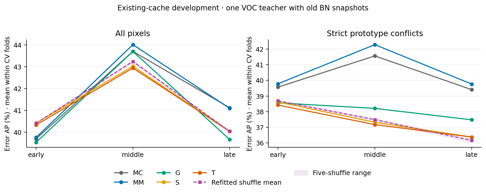
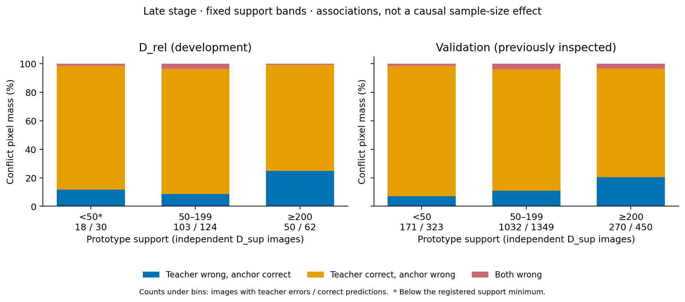

# 锚点异议可信度：有界缓存验证结果

状态：三个阶段全部完成，2026-10-23 13:13:05（北京时间）结束，正式队列耗时 24 分 06 秒。75 个正式产物已在服务器逐一核验大小与 SHA256，68 个小型聚合文件取回后再次核验。主表、固定门槛与冲突类型分解已独立复算。

## 结论与范围

本轮固定门槛未通过。以原型的 D_sup 独立图像支持量为可靠性代理，加入四个固定“异议×支持量”交互，没有得到超过 MC＋margin、普通锚点控制和支持量主效应的可重复增量。真实类别对应相对重新拟合的打乱对照也没有形成稳定优势。按计划停止扩大本版评分器，未重训教师。

这项结论对应本轮固定的支持量代理和低维评分器。它不是所有锚点质量特征、表征或学习机制都无效的证明。数据仍来自旧 BN 保存策略的一个 VOC 教师轨迹；三个阶段、五个置换及交叉验证折不能充当独立教师或数据集重复。

## 固定设计与实现核验

[详细计划](ANCHOR_TRUST_AUDIT_PLAN_20261023.md) 首先以 `0fbcc793` 推送；正式实现为 `93cb036e56c8c522e1d02f2a8a68ae1b4e667193`，机器协议 SHA256 为 `3bf4fd8b73044a1553f62d4eca40768677224ff20a6096bac2ca7a2b63483f6d`。并列原型支持量随原始获胜元组搬运的细则在真实拟合前固定。独立模型核验工具版本为 `6bc504b7`；后续汇总和图表排版没有改变评分器、协议或候选。

使用 D_sup=1,191 图的现有原型、D_rel=132 图和每图最多 1,024 个原抽样像素。所有选择留在 D_rel 的三折外层、三折内层图像 CV；沿用上一轮图像划分。三个阶段的全部拟合先冻结，再计算固定 D_rel 门槛，最后才读取已查看的 1,449 图 validation 作开发描述。

主估计量为三个外层折各自指标的等权平均。配对 bootstrap 在各折的完整图像池中抽样 2,000 次，再聚合折指标；不混合不同折的分数形成一次主排序。pooled OOF 完整保留为次要结果。本轮与上一轮 pooled 主表的数值不可直接作方法改进比较。

MM 是包含单调 MC 回退、线性 MC＋margin 和加性 MC＋margin 的候选策略。G 包含普通 prototype/product/uniform/e/top-2 异议控制；S 再增加首选类、竞争类、原型首选类的支持量主效应；T 再增加四个固定交互。G/S/T 均可退回较简单候选。所有修正使用全批 FP64 凸优化，固定 L2 和收敛条件，没有增加网络、搜索更新预算或训练教师。

七项本地检查及 CPU/GPU 完整合成流程通过。三个阶段各 260 个修正拟合，共 780 个，最多分别使用 4/5/5 次 Newton 更新即收敛，最终最大梯度不超过 `9.69e-8`。独立 NumPy 核验的 180 次已选模型重放最大差 `3.55e-15`，240 项目标梯度检查最大值 `9.36e-8`。没有发现标签符号、类别置换不变量、模型重放或未收敛问题能够推翻本轮结果。核验为只读操作，没有新增拟合。

三阶段共 4,743 个真实缓存分片通过原型、标签、特征和哈希检查。置换保留量最大差为 0，`p2=MC−margin` 最大误差 `5.55e-17`，FP64 重算与旧 FP32 分数最大差 `1.24e-6`。这些是数据链路与数值检查，不能消除旧 BN 快照、小开发集或模型家族受限等研究边界。

## 主结果：冲突内错误识别

下表为 D_rel 错误 AP，单位 %，错误为正类，数值越大越好。所有行使用同一冻结预测和相同图像折。

| 候选策略 | early | middle | late |
| --- | ---: | ---: | ---: |
| MC | 39.567 | 41.568 | 39.405 |
| MC＋margin（MM） | 39.782 | 42.290 | 39.765 |
| 普通锚点（G） | 38.558 | 38.207 | 37.473 |
| 支持量主效应（S） | 38.615 | 37.310 | 36.370 |
| 可信度交互候选策略（T） | 38.419 | 37.166 | 36.370 |
| T−MM，百分点 | −1.363 | −5.124 | −3.396 |

late 四项主对照使用各 98.75% 配对图像区间，均未达到下界大于零的条件：

| 对照 | ΔAP，百分点 | 区间 |
| --- | ---: | --- |
| T−MM | −3.396 | [−8.140, +0.952] |
| T−G | −1.104 | [−3.554, +1.563] |
| T−S | 0.000 | [0.000, 0.000] |
| T−五个 refit 打乱对照的指标均值 | +0.214 | [−1.022, +1.396] |

本轮 late 的 T−MM 在三个外层折分别为 −1.907、−0.212、−8.069 个百分点，均为负点估计。因此，当前失败不依赖上一轮那种跨折分数混合造成的大幅 pooled 退化。区间跨零仍应保留，不能把这些点差写成每个折都已证明显著伤害。

T 相对 MM 的总体 AP 点差为 +0.574、−1.072、−1.050 个百分点；三个阶段都未通过预定的“95% 下界大于 −0.5 点”非劣门槛。未通过非劣门槛表示不能排除超过容忍范围的退化，不等同于已证明总体显著退化。

## MC＋margin 与最终模型选择

MM 相对 MC 的总体 AP 增量依次为 +0.063、+0.307、−0.026 点；冲突内为 +0.215、+0.722、+0.360 点。中期总体增量的名义 95% 区间为 [+0.031,+0.530]，冲突内为 [+0.096,+1.395]；早期和后期区间跨零。这是有限的、阶段相关的开发增量，不是稳定跨阶段的新机制证据。第二大概率没有另设重复候选，代码核验了 `p2=MC−margin`。

全 D_rel 候选 OOF NLL 的选择结果中，T 最终在 early 选择 S，在 middle/late 都选择 MM_additive；没有一个最终 T 模型保留新增交互。late 外层 T 依次选择 S、S、G，因此 T 与 S 的后期预测及区间完全相同，不能把候选集合的名字 T 当成实际用了交互。

| 全 D_rel 候选 OOF NLL | early | middle | late |
| --- | ---: | ---: | ---: |
| MM_additive | 0.186792 | 0.156545 | 0.156154 |
| 原始 G 候选 | 0.185975 | 0.157226 | 0.157407 |
| 原始 S 候选 | 0.185320 | 0.158772 | 0.158290 |
| 原始 T 候选 | 0.185610 | 0.159357 | 0.158632 |

原始 T 候选在三个阶段的 OOF NLL 都没有超过 S。中后期所选锚点策略的外折 NLL 也比 MM 更差，不能把失败全部归因为 NLL 与 AP 的目标差异。包含回退候选能在全 D_rel 最终选择中放弃锚点修正，却不能保证小样本内层选择在外层一定成功回退。

## 类别对应打乱：固定评分器与重新拟合须区分

五个置换保持每个像素的分类器概率、相似度集合、原型间隔、uniform、冲突状态及原型元组自身支持量不变，仅改变非首选类别与原型元组的对应。每个置换都重新拟合相同的 G/S/T 与回退策略。

真实 T 相对五个 refit 打乱对照的平均 AP 差，early/middle/late 为 −0.266、−0.317、+0.214 点，只有一个阶段为正。late 对每个置换的点差都为正，但幅度小且与打乱均值的区间跨零，不满足跨阶段和区间条件。

| 冲突内错误 AP，% | early | middle | late |
| --- | ---: | ---: | ---: |
| 真实对应 T | 38.419 | 37.166 | 36.370 |
| 固定真实模型、打乱输入，五次均值 | 36.842 | 36.245 | 33.930 |
| 每次打乱后重新拟合，五次指标均值 | 38.686 | 37.482 | 36.155 |

固定真实评分器、仅打乱其输入时，late AP 会下降约 2.44 点；重新拟合后与真实对应的平均差只剩约 0.21 点。因此，“打乱输入后下降”不能单独证明真实类别对应提供了独有信息；它也受到已拟合模型面对改变后的输入关系的影响。本轮保留两种结果，主结论采用 refit 控制。五个负控制不是独立教师，也未被转换成置换检验 p 值。

## 原型支持量：存在粗粒度关联，未形成条件增益

下面是 late D_rel 严格冲突中，按原型首选类 c 的独立 D_sup 图像支持数分组的加权像素比例。它们是原始组成统计，尚未控制 MC、margin 或类别。

| 原型支持图像数 | 教师错、原型对 | 教师对、原型错 | 两者均错 | 含错/含对图像数 | 支持合格 |
| --- | ---: | ---: | ---: | ---: | --- |
| <50 | 11.54% | 86.91% | 1.55% | 18 / 30 | 否 |
| 50–199 | 8.68% | 87.64% | 3.67% | 103 / 124 | 是 |
| ≥200 | 24.81% | 74.43% | 0.76% | 50 / 62 | 是 |

较高支持组的原型提出正确替代的比例更高，这个描述性信号应保留。但是，该组仍有约四分之三的异议属于教师正确、原型误报；支持量与类别组成绑定，不能据此证明增加标注样本数会造成改善。S 主效应和 T 交互的外折对照没有把这种粗粒度关系转化为超过 MM/G 的稳定条件收益。

完整固定分层保留所有空组和不足组。late D_rel 冲突中，预测类×边界只有 3/42 个登记单元达到支持阈值，按原型首选类分组只有 1/21 类达到阈值。MC×margin 及其与支持档的联合网格另外含有概率约束导致的不可达组合，不能把所有空格都解释为采样不足。本轮没有按结果选择类别或放宽阈值，当前数据不支持直接扩成 21 类自由可靠性参数。

具体而言，16 个 MC×margin 登记格中有 7 个非空且合格；48 个与 c 支持档的联合格中有 21 个非空，只有 9 个合格。validation 对应为 7/7 和 19/21 个非空格合格，说明开发端条件分层的支持明显更有限；不能用较大的 validation 重新选组或调参。

## 同覆盖率、同精度与训练权重

late D_rel 冲突内，MM 的 P@90 为 90.334%，T 为 89.891%，下降 0.443 点；MM 的 C@95 为 70.108%，T 为 68.388%，下降 1.720 点。两项预定工作点均未改善。

各阶段记录了 sigmoid 正确性权重的均值、错误权重占比和保留正确样本质量，并同时报告 NLL、Brier、AUROC、AP 与风险—覆盖曲线。它们是冻结缓存的权重诊断；本轮没有测量端到端训练收益，不能把更低校准损失或单个工作点变化当作最终训练改进。

## Validation 开发描述与产物核验

validation 已在此前研究中查看，不参与本轮拟合、选择或继续门槛，也不被称为独立确认集。以下是冻结全 D_rel 最终模型后的描述性错误 AP，单位 %。

| 阶段 | MM 总体 | T 总体 | MM 冲突 | T 冲突 | T 实际选择 |
| --- | ---: | ---: | ---: | ---: | --- |
| early | 40.198 | 38.361 | 41.246 | 40.509 | S |
| middle | 37.791 | 37.791 | 40.838 | 40.838 | MM_additive |
| late | 36.487 | 36.487 | 39.573 | 39.573 | MM_additive |

early 的非零支持修正在 validation 总体落后 MM 1.836 点、冲突内落后 0.736 点。其总体训练权重均值从 MM 的 0.93076 提高到 0.94116，但错误像素占总权重的比例也从 4.496% 提高到 4.683%；冲突内该比例从 11.783% 提高到 12.315%。更多权重没有对应更高的权重纯度。middle/late 的 T 与 MM 完全相同，不能记为锚点收益。

late validation 中，MM/T 总体 P@90=98.084%、C@98=90.566%；冲突 P@90=89.031%、C@95=51.197%。较高支持档的“教师错、原型对”比例仍较高（20.42% 对中档 10.96%、低档 7.13%），但这是未控制类别和竞争强度的描述关系，没有改变 D_rel 门槛。

全部 2,160 行排序、区间、候选选择、固定分层、收敛曲线和模型系数均留档。汇总工具重新计算各折均值，核对本地/服务器门槛完全一致，并验证每个非空严格冲突组的三种结果比例和为 1。图像、像素级 GT/logits/特征和 checkpoint 没有加入 GitHub。

这是一轮在已查看数据上登记边界的开发研究。固定计划使追加工作可追踪，不能把开发集上的区间升级成未触及数据上的确认性证据。

## 执行决定

停止本版基于支持图像数的异议信任评分器扩展，保留全部阴性、零增量及局部正向开发结果。不增加优化预算、置换种子、公式、类别筛选或教师训练。后续若研究新的锚点质量指标，应提出不同且可检验的具体信息来源，并重新登记开发与独立确认设计；本轮结果不构成自动继续投入的依据。

## 可复算产物

- [固定机器协议](../anchor_trust_protocol.json)、[详细计划](ANCHOR_TRUST_AUDIT_PLAN_20261023.md)。
- [完整小型完成快照与文件哈希](../records/anchor_trust_audit_20261023/complete/)，包含候选、系数、折划分和优化曲线。
- [汇总表与两张科学图](../records/anchor_trust_audit_20261023/summary/)、[逐项门槛](../records/anchor_trust_audit_20261023/summary/gate.json)。
- [独立 NumPy 重放与梯度核验](../records/anchor_trust_audit_20261023/independent_model_audit.json)、[汇总算术核验](../records/anchor_trust_audit_20261023/summary/verification.json)。

复算命令：`python -m research.label_anchored_competition.summarize_anchor_trust --source research/label_anchored_competition/records/anchor_trust_audit_20261023/complete --output /new/anchor-trust-summary`。输出必须是新目录；该命令不重新拟合模型。
