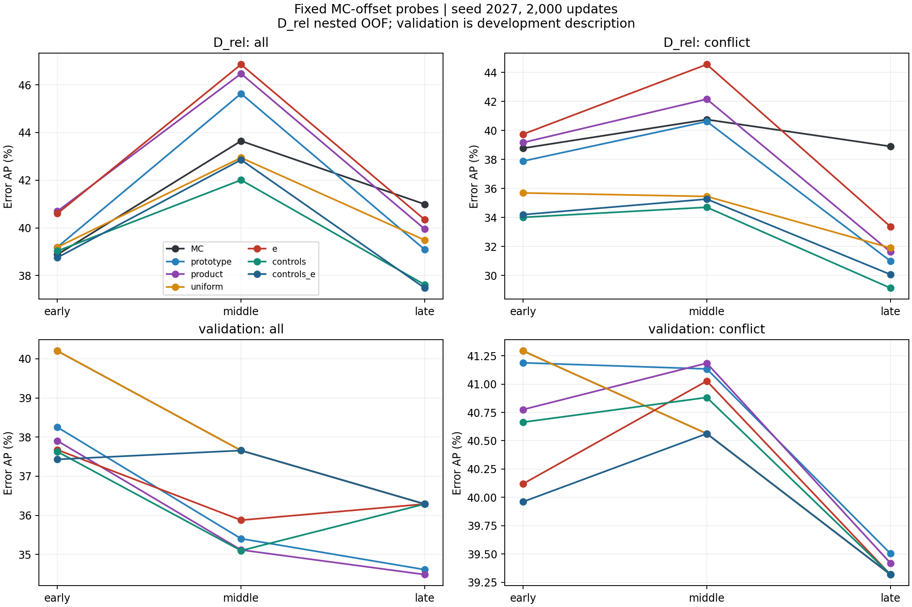
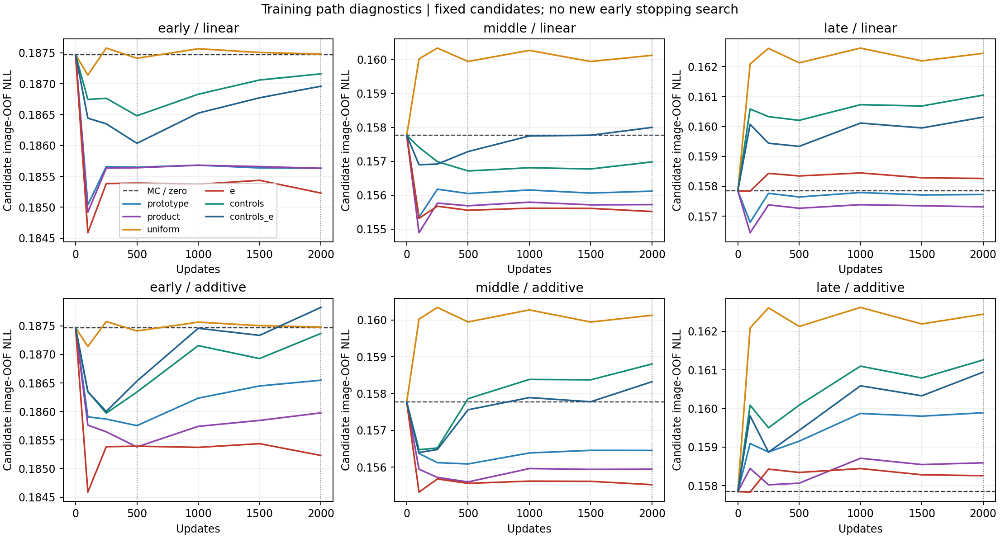

# 保留 MC 的评分器审计：结果与下一步决策

**本轮三阶段审计已完成，固定资源门槛未通过，不启动修复 BN 的教师重训，也不追加当前 e 公式的预算或机制。** 保留 MC 后能恢复一部分原小 MLP 的损失；e 在 early/middle 有开发信号，但没有建立跨阶段、跨 fold 且超过 MC 与简单控制的稳定收益。这里不能进一步推断“e 完全没有条件信息”，也不能说它始终被 uniform/product 支配。

研究对象是同一条旧 BN 保存策略下的 VOC seed42 教师轨迹。正式重跑于北京时间 2026-10-23 07:53:32 启动，early/middle/late 分别于 08:13:20、08:14:16、08:14:30 完成，耗时 19 分 45 秒、20 分 41 秒、20 分 55 秒。网络曾短暂中断，任务独立运行并完成；之后通过原入口取回结果。没有训练新教师。

所有 54 个完成产物在服务器校验大小和 SHA256；取回 56 个小型结果／收据文件，张量留在服务器。另追加的只读 OOF 复核不拟合参数、不修改选择或门槛，9 个小型产物单独存档。

## 设计与可解释范围

本轮按 [固定计划](BOUNDED_SCORE_AUDIT_PLAN_20261023.md) 执行。计划提交 `52111ff7` 早于任何新探针拟合；新协议 SHA256 为 `99a55d07e1bea0d73cbb1ddc87cc071af080361180c702acd3e299c72b966bbe`。实际完成版本为 `ce6b19e5140d6a141c51ea22b1b3364d6201e50a`，三个完成收据均一致。

- 数据固定为原 VOC 划分：D_sup 1,191 图构造表征和原型，D_rel 132 图拟合评分器，已查看的 validation 1,449 图只作开发描述。early/middle/late 为同一个教师的三个阶段。
- 每图使用原缓存前 1,024 个抽样像素，以有效像素数除以抽样数加权。所有评分器使用同一预测、标签、像素和图像划分。
- 在每个训练 fold 内先拟合单调 MC-only 正确性校准器，再固定其输出，追加零、线性或分段线性加性修正。六种输入为 prototype margin、product 修正、uniform、e、前三种控制信号的组合、组合加 e。
- D_rel 使用三折外层、三折内层图像 CV。内层按 NLL 选择形式，外层记录所选策略的 OOF 结果。最终模型在 D_rel 候选 OOF 中选择并用全部 D_rel 重拟合；所有模型保存后才读取 validation。
- 只比较 500/2,000 次更新和两个固定 minibatch 种子 2027/2028。500 为同一轨迹前缀。两采样种子不是两个独立教师。
- e 的新表达式、signed evidence、多原型、新表征和端到端矩阵均不在本轮范围。

MC-only 校准器在每个固定模型内严格保持 logit MC 排序。不同外层 fold 的校准参数不同，所以 pooled OOF MC 与原始 MC 的总体排序可以不同。主比较始终使用同一组 OOF MC；同时保留原始 MC、logit MC、entropy、margin 的参考结果。

按 NLL 选择不保证 AP 最优，包含零修正也不保证外层或 validation 一定优于 MC。必须同时看候选曲线、所选策略和目标工作点。本文不把有限探针失败写成条件信息不存在的数学证明。

## 实现与数据链路核验

41 项本地测试通过，包括独立优化器对照、MC 单调性、精确零回退、图像隔离、500 前缀的缩小预算回归、序列化、常量／稀疏特征、停止门槛以及原 BN 保存回归。修复后的服务器 GPU smoke 与 CPU 指标最大差 `3.33e-16`。这些检查仅建立工程可信度。

首次不可变发布 `1db8146c` 在未完成时中止：复查发现零值集中的输入会让最小分位数 hinge 与线性项成为同一基函数。原实现只去重折点，没有去重等价列，可能改变 L2 的有效强度。修复按已登记要求去除数值等价列，没有改变候选、预算、数据或门槛；在读取任何效果结果前终止并保留三阶段中止记录。正式重跑使用新目录，旧输出未覆盖。

真实缓存共 **4,743 个分片**通过 SHA256、图像角色、GT 与原 argmax 正确性核验；原型图像与 D_rel/validation 无重合。特征乘原型与缓存相似度的最大绝对误差为 `7.75e-7`，单位范数最大误差 `4.77e-7`，独立 FP64 重算 e 的最大误差 `1.65e-7`。对 product 修正使用数值稳定的 log-moment 恒等式计算，不在 MC 接近 1 时相减两个饱和概率。

只读复核使用保存的外层模型、基函数和实际缓存重放 e 的 OOF 预测：三阶段×三 fold×两个采样种子，共 **18 次完全一致，最大差为 0**。这排除了本轮已检查的模型序列化／重放不一致，并不排除所有建模和实验设置问题。[缓存核验](../records/bounded_score_audit_20261023/summary/cache_checks_summary.json)，[只读复核](../records/bounded_score_audit_20261023/posthoc/)。

## 结果与资源门槛

下列 AP 都以伪标签错误为正类，单位为百分数；差值为百分点。主设置为 sampler seed2027、2,000 更新，D_rel 行使用 nested OOF。`controls` 指 prototype、product、uniform 三输入，`controls+e` 再加入 e。

| 修正输入 | early 总体 | middle 总体 | late 总体 | early 冲突 | middle 冲突 | late 冲突 |
| --- | ---: | ---: | ---: | ---: | ---: | ---: |
| MC / 零修正 | 38.881 | 43.646 | 40.992 | 38.773 | 40.748 | 38.901 |
| prototype margin | 39.196 | 45.632 | 39.089 | 37.888 | 40.617 | 30.999 |
| product | 40.699 | 46.468 | 39.950 | 39.164 | 42.155 | 31.628 |
| uniform | 39.191 | 42.943 | 39.488 | 35.694 | 35.453 | 31.907 |
| e | 40.601 | 46.855 | 40.344 | 39.741 | 44.546 | 33.374 |
| controls | 39.030 | 42.008 | 37.618 | 34.013 | 34.706 | 29.141 |
| controls+e | 38.756 | 42.855 | 37.477 | 34.200 | 35.268 | 30.074 |

| late 冲突内主比较 | ΔAP | 配对图像区间 | 判定 |
| --- | ---: | --- | --- |
| controls+e − controls | +0.933 | [−0.403, +2.176]，98.75% | 不确定 |
| e − prototype | +2.375 | [+0.602, +4.697]，98.75% | 正向 |
| e − product | +1.746 | [−0.017, +3.935]，98.75% | 不确定 |
| e − uniform | +1.468 | [−1.203, +5.163]，98.75% | 不确定 |
| e − MC | −5.527 | [−8.102, −1.728]，95% | pooled OOF 负向；见下方折内限制 |

四项主比较只有 e−prototype 的下界大于零。early/middle 的 e−MC 冲突 AP 分别为 +0.968 [−1.790, +4.016]、+3.797 [+0.044, +8.174]（95%）。e−product 在 early/middle 为 +0.577 [−0.913, +1.827]、+2.390 [+0.222, +4.515]（98.75%）。因此应保留 middle 的开发信号，不能笼统写成“完全无效”，但它不足以满足跨阶段和 late 的固定门槛。

本轮没有触发主设置下的**总体明确退化**保护条件：例如 late 总体 e−MC 是 −0.647 [−3.480, +2.293]，controls+e−controls 是 −0.141 [−0.816, +0.652]（95%）。未检出明确总体退化不等于证明无损。失败主要来自 late 冲突内增量不足、MC 保护条件失败和一项预算稳定性失败。[完整门槛](../records/bounded_score_audit_20261023/summary/gate.json)。

原始 MC 仍是必要参考。early/middle/late 的 D_rel 总体 raw MC AP 为 40.177/44.573/41.209，均高于对应 pooled 校准 MC。因此，e 对校准 MC 的早期增量不能全部解释为超过原始 MC 的信息收益。D_rel 冲突内 raw entropy AP 为 41.935/44.093/39.548，raw margin 为 35.981/38.201/36.610；e 也没有相对这两个原始参考形成三个阶段一致的优势。这些参考没有用于重新选择候选。

### 预算与采样种子稳定性

| late 冲突内 ΔAP | 2027 / 500 | 2027 / 2,000 | 2028 / 500 | 2028 / 2,000 |
| --- | ---: | ---: | ---: | ---: |
| controls+e − controls | +2.140 | +0.933 | +2.340 | +0.963 |
| e − prototype | +0.673 | +2.375 | +3.975 | +3.575 |
| e − product | −0.745 | +1.746 | +2.868 | +3.114 |
| e − uniform | +1.400 | +1.468 | +4.464 | +4.349 |
| e − MC | −5.537 | −5.527 | −2.717 | −2.630 |

e−product 有一次反向；e−MC 四个设置均为负。2,000 更新未将 late 的核心结论翻转。与此同时，不能据此说 uniform/product 稳定支配 e：e 相对 uniform 四个点差都为正，三个阶段也有正向点估计。停止扩展的依据是**缺少稳定、独有且保住 MC 的收益**。

| e 线性候选的 D_rel OOF NLL，seed2027 | MC / 0 | 500 | 2,000 |
| --- | ---: | ---: | ---: |
| early | 0.187467 | 0.185392 | 0.185230 |
| middle | 0.157766 | 0.155557 | 0.155520 |
| late | 0.157848 | 0.158344 | 0.158259 |

late 对应的训练 NLL 从 500 的 0.152974 到 2,000 的 0.152977 基本不变；其 OOF NLL 始终高于 MC。这不支持把失败仅归因为更新数不足。曲线上较早的点可能更好，但 100/250 等点只作诊断，没有据此增加候选或重选停止点。

训练和留出曲线全部保存在各阶段的 `training_curves.csv`；上图为候选外层留出 NLL 聚合，不是再一轮超参数选择。

### 已查看 validation 的开发描述

| 阶段 | MC 总体 AP | e 总体 AP | MC 冲突 AP | e 冲突 AP | e 的最终形式 |
| --- | ---: | ---: | ---: | ---: | --- |
| early | 40.200 | 37.674 | 41.292 | 40.120 | linear |
| middle | 37.656 | 35.876 | 40.562 | 41.027 | linear |
| late | 36.288 | 36.288 | 39.319 | 39.319 | zero |

late 的 e、uniform、controls、controls+e 在**两个预算×两个采样种子中全部选择零修正**。这是真实的 MC 回退，不是增益。原小 MLP 的 late e AP 为 32.625%，现在恢复到 36.288%，说明原先相对 MC 的损失可以通过回退避免；不能将它全部归因于 e 没有信息，也不能把恢复当作 e 有效的证据。本轮同时改变了评分形式和选择流程，并非对 MLP 结构单因素归因。early/middle 的非零 e 修正在 validation 总体仍分别落后 MC 2.526/1.780 点。validation 没有参与任何门槛判定。

### 同覆盖率／同精度工作点

以下全部为 late、主设置。P@90 表示保留所在范围 90% 像素后的精度；C@98/C@95 表示达到相应精度的描述性最大覆盖率。数值均为百分数。

| D_rel OOF | 总体 P@90 | 总体 C@98 | 冲突 P@90 | 冲突 C@95 |
| --- | ---: | ---: | ---: | ---: |
| MC | 97.033 | 85.872 | 89.794 | 65.231 |
| prototype | 96.970 | 85.657 | 88.889 | 61.277 |
| product | 96.985 | 85.697 | 88.996 | 61.758 |
| uniform | 96.909 | 84.643 | 88.939 | 51.107 |
| e | 97.017 | 85.712 | 88.829 | 61.275 |
| controls | 96.866 | 85.324 | 88.710 | 58.814 |
| controls+e | 96.868 | 85.342 | 88.871 | 60.132 |

| validation 描述 | 总体 P@90 | 总体 C@98 | 冲突 P@90 | 冲突 C@95 |
| --- | ---: | ---: | ---: | ---: |
| MC、e（零修正） | 98.084 | 90.561 | 89.006 | 51.143 |
| prototype | 98.041 | 90.277 | 89.021 | 50.406 |
| product | 98.035 | 90.227 | 89.018 | 49.801 |

e 在 late D_rel 冲突内 P@90 比 MC 低 0.965 点，C@95 低 3.957 点。middle 的 e 冲突 AP 虽提高，但 C@95 从 MC 的 66.677% 降至 66.407%；AP 改善不能替代目标工作点改善。全部预定工作点见 [precision_targets_primary.csv](../records/bounded_score_audit_20261023/summary/precision_targets_primary.csv)。这些覆盖率使用所在评估集 GT 描述曲线，不是用 validation 选部署阈值；单独保存的 D_rel 阈值迁移结果带有重拟合尺度变化限制。

## 需要保留的实验设置限制

**1. pooled OOF 的大幅退化不是每个 fold 都退化。** 只读复核得到：

| 阶段：冲突内 e−MC AP | fold0 | fold1 | fold2 | pooled OOF |
| --- | ---: | ---: | ---: | ---: |
| early | −0.488 | +2.888 | +6.659 | +0.968 |
| middle | −0.741 | +3.092 | +13.660 | +3.797 |
| late | −0.847 | +1.620 | 0.000 | −5.527 |

late 三个 fold 的冲突错误率为 12.621%、18.189%、8.670%；前两个选择非零 e，第三个退回 MC。不同 fold 的校准器、修正强度、选择结果和错误率共同影响池化排序。−5.527 是固定评估流程的有效输出，却不能改写成“每个固定教师子集的 e 排序都明显更差”。本轮不事后改用折内平均 AP 来放宽门槛，也不把条件于既有 OOF 预测的图像 bootstrap 当成训练总体不确定性。将来若另立研究，须预先同时登记折内指标聚合与跨 fold 分数可比性。

**2. 候选选择对微小 NLL 差异敏感。** late fold2 的 e 非零候选相对零修正，seed2027 在 2,000 更新差 +0.000016，选择 zero；seed2028 差 −0.000073，选择 linear。这解释了两个采样种子 pooled AP 的较大差异的一部分。零候选提供回退能力，并不保证嵌套选择器在新图像上可靠回退。

**3. 本轮 e 的加性候选实际退化为线性。** 全体像素的 e=0 占比约 79–83%，预定 25/50/75% 折点落在最小值；去除等价基函数后，e 和 uniform 的加性形式与线性形式相同。因此，这不是一次充分的“冲突内非线性关系不存在”检验。本轮按约定不事后改为正值分位点、不增加容量或预算。

**4. 学到的方向与原异议降权动机相反。** 主设置非零 e 修正系数为 +0.141 至 +0.317，位于正确性 logit 上，表示固定 MC 时更大的 e 获得更高的预测正确性。独立读取真实缓存计算的训练集零点 BCE 梯度为负，与这个方向一致；没有发现标签正负号或 OOF 重放错误。但这是特定基线、损失和总体像素混合下的条件拟合，不能声称每个类别／置信度区间均如此。它支持重新研究“何时该信任异议”，不支持直接把符号翻转作为新方法。

## 条件分层、原型支持与分布差异

分层边界在拟合前固定。输出全部 56 个 MC×prototype margin 单元、42 个预测类×边界单元，以及 2,352 个完整四维支持量单元。空组和不足组保留，不按结果选类别。支持要求为至少 20 张含错图、20 张含正确像素图、100 个抽样错误像素、100 个抽样正确像素。

| 达到支持阈值的单元 | early D_rel / val | middle D_rel / val | late D_rel / val |
| --- | ---: | ---: | ---: |
| MC×prototype，共 56 | 19 / 45 | 20 / 49 | 23 / 44 |
| 预测类×边界，共 42 | 4 / 21 | 4 / 22 | 4 / 22 |
| 四维支持量，共 2,352 | 9 / 110 | 6 / 113 | 6 / 104 |

在达到支持阈值的 D_rel MC×prototype 单元中，e−MC AP 为正的数量依次为 **2/19、7/20、0/23**；controls+e−controls 为 **8/19、13/20、7/23**。这些是全量固定分层的描述性计数，没有逐组置信区间，也仍受跨 fold 分数比较影响，不构成条件独立性证明；没有按正向组重新筛选类别。late validation 的 e 退回 MC，所以 44 个有支持单元全部相同。

late D_rel 的四个有支持 class×boundary 单元仅覆盖 background/person 各自的边界和内部。其余 19 类均不足，不能把它们判成无效。21 类原型的独立支持图像数为 23–1,191，去除背景后为 23–466；但原型支持量充足不等于 D_rel 中有足够图像学习逐类可信度。完整 21 类、空单元和所有支持计数保留在各阶段 `joint_support.csv`，没有隐藏稀少类别。

本轮统计残余最大概率和 e/top-2 相关性，分别报告总体、冲突、高 MC、高 MC 冲突；另报告 D_rel 与 validation 的错误率、分数分位数、归一化特征总体及逐预测类均值／方差。特征均值余弦、均值向量距离和按维标准化均值差只是描述性分布指标，不能单独归因泛化失败。

对 `d_k=[s_k−s_a]+`，由于余弦相似度使 `0≤d_k≤2`，残余概率最大的类别 b 满足 `|e−d_b|≤2(1−r_b)`。因此，残余质量高度集中时，e 接近 top-2 异议量有直接数值原因；但该上界与总体相关性均不能替代冲突内增量实验。

| late 实际缓存 | D_rel 总体 | val 总体 | D_rel 冲突 | val 冲突 | D_rel 高 MC 冲突 | val 高 MC 冲突 |
| --- | ---: | ---: | ---: | ---: | ---: | ---: |
| 错误率，% | 6.738 | 4.819 | 13.526 | 14.564 | 5.822 | 7.812 |
| 残余最大概率均值 | 0.521 | 0.498 | 0.799 | 0.793 | 0.769 | 0.764 |
| 残余最大概率≥0.9，% | 16.655 | 13.900 | 45.455 | 42.107 | 37.414 | 33.900 |
| e/top-2 Pearson | 0.9943 | 0.9945 | 0.9868 | 0.9887 | 0.9770 | 0.9808 |
| e/top-2 加权 Spearman | 0.9858 | 0.9889 | 0.9852 | 0.9868 | 0.9740 | 0.9789 |

这支持“e 与 top-2 异议高度相关”，但不支持“几乎所有残余分布都是 one-hot”：late validation 冲突中只有约 42% 的残余最大概率≥0.9。高 MC 冲突内仍有很高相关性，也不能只用全体 e=0 造成的并列来解释。

D_rel 总体错误率在三个阶段均高于 validation（7.816 vs 5.995、6.951 vs 5.162、6.738 vs 4.819%），但冲突子集及高 MC 冲突内的关系并非相同。late 高 MC 冲突为 5.822 vs 7.812%，说明仅看总体错误率会遗漏条件组成差异。

总体归一化特征均值余弦相似度 early/middle/late 为 0.9940/0.9935/0.9946，按维标准化均值差 RMS 为 0.0829/0.0854/0.0789；没有证据据此宣称发生巨大全局表征漂移。逐预测类均值／方差和差异都已存档，稀有类解释须同时看支持量。[分布](../records/bounded_score_audit_20261023/summary/distributions.csv)，[特征差异](../records/bounded_score_audit_20261023/summary/feature_shift.csv)，[完整联合差值](../records/bounded_score_audit_20261023/summary/joint_deltas.csv)。

## BN 与后续边界

本轮读取旧 checkpoint 的原始缓存，没有修复旧缓存或用重新校准的 BN 混入比较。此前完整 validation 的重载 FP16 mIoU 相对日志分别变化 +0.050、−0.063、+0.064 个百分点，不能证明条件 AP 不受影响。BN 缺陷存在、未来保存已修复，与本轮评分器比较应分开记录。

本轮 D_rel 门槛失败，故**没有投入正确 BN 的 seed42 教师，没有执行新的真实多卡训练 smoke，没有启动 seed43、第二数据集或端到端矩阵**。当前未发现能推翻结果的数据链路／符号／重放错误；池化 OOF、稀疏基底和小 D_rel 的选择不稳定则是实际的解释限制。不能把这份报告写成对正确 BN 教师下同一机制的确定反证。

下一步按以下顺序收束：

1. 结束当前 e 公式的追加优化和训练扩展。保留 early/middle 正向开发结果，以及 late 的不确定／负向结果；不寻找新的更新预算、正值折点或 signed 版本来救回本轮门槛。
2. 若保留“标签锚点异议可信度”这一宽泛方向，另行登记一个小问题：在 MC 与普通 prototype/product 已知时，粗粒度类别／原型支持量的收缩估计是否减少误杀。当前 132 图不支持直接拟合 21 类自由可靠性参数；应优先共享参数、支持量分组和向 MC 回退，并预先处理折内指标与池化分数的可比性。目标仍是同覆盖率／同精度优于强基线，不能只提高原型分类准确率。
3. 一致错误和 e=0 盲区仍保留原诊断；本轮没有改变其机制。多原型、新表征和新教师都需要新的简单控制证据，不从本次不稳定结果自动展开。
4. 只有新登记的开发证据达到门槛后，才考虑一次正确 BN 的固定 seed42 确认：先通过真实多卡保存前后 eval 一致性，再完整重建原型和缓存；BN 修复和方法变化分别记录。

**当前可支持的论文叙述是：MC 保留与回退解决了部分评分器退化，但残余加权异议尚未显示稳定、独有的实用增量。** 当前数据不支持直接将这版公式包装为新主线，也不足以否定所有标签锚点方法。

## 产物与复算

- [固定计划](BOUNDED_SCORE_AUDIT_PLAN_20261023.md) 与 [机器协议](../score_audit_protocol.json)。
- [三阶段完成收据、模型、候选选择、训练曲线和全部固定诊断](../records/bounded_score_audit_20261023/complete/)。
- [汇总、固定门槛及图表](../records/bounded_score_audit_20261023/summary/)。每张图已检查，PNG/SVG 均保存。
- [只读 OOF 重放、折内指标和系数方向](../records/bounded_score_audit_20261023/posthoc/)，与正式门槛分开。
- 复算汇总：`python -m research.label_anchored_competition.summarize_score_audit --source research/label_anchored_competition/records/bounded_score_audit_20261023/complete --output /new/summary-directory`。不修改旧目录，不重新拟合。
