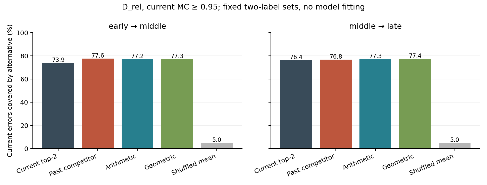
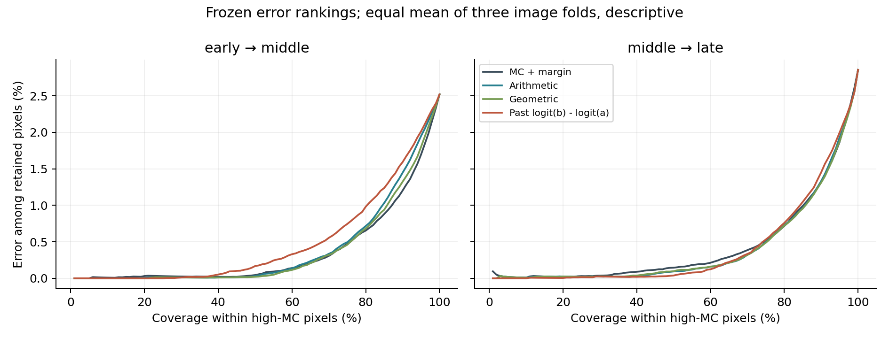

# 历史竞争信息：缓存筛查结果与停止决定

本轮已完成，固定的“保留当前首选类，再加入过去最强非首选类”方案未通过登记门槛。没有拟合任何新探针，也没有更新教师或学生。历史类别对应包含真实语义，但尚未建立超过当前 Top-2 和普通历史集成的稳定增量。这个结论只停止当前两类候选方案，不证明所有历史特征都不能用于错误排序。

计划先以 `dc277d2b` 提交，正式执行源码为 `6be5ec0e73ce865af3346184e094037292baef1e`，协议 SHA256 为 `4677f64c6c2da7ebc75d60cf6558e708c9e6f94a56ecc8d00adb7d8c93560120`。2026-10-23 北京时间 22:08:48 启动，22:15:45 完成，程序内部计时 415.74 秒；CPU 四线程，新增拟合数和教师更新数均为 0。

## 1. 执行范围与证据身份

使用旧 BN 保存策略下 VOC seed42 的 early/middle/late 三份既有冻结缓存，只比较 early→middle、middle→late。D_sup=1,191，D_rel=132，validation=1,449；每图仍取原缓存顺序前 1,024 个像素，没有重新采样或按结果选择图像。validation 已被前几轮查看，本次只作开发描述。

执行顺序为 D_rel 全部对齐与分析 → 22:09:31 写定失败门槛 → 跳过新拟合 → 读取 validation → 完成描述。所有选择和门槛只依赖 D_rel。详细计划与完整停止条件见 [登记计划](HISTORICAL_COMPETITION_PLAN_20261023.md) 和 [机器协议](../history_protocol.json)。

| 角色 | 图像数 | 校验原分片 | 每阶段完整对齐像素位置 | 实际分析像素位置 |
| --- | ---: | ---: | ---: | ---: |
| D_rel | 132 | 396 | 540,672 | 135,168 |
| validation | 1,449 | 4,347 | 5,935,104 | 1,483,776 |

三阶段图像集合、完整 pixel_indices/yx/GT/boundary、原图尺寸和有效像素数均一致。每阶段 argmax 与缓存伪标签、correct 一致，全部 4,743 个分片的原 manifest 身份、字节数和 SHA256 通过；没有删除错位样本，也没有只取交集。

保存的 MC/MM 基线来自此前 `93cb036e` 的同一图像折划分。模型、旧预测和旧像素池哈希均核验；MC 重放最大差为 0，MM 最大差为 7.244×10⁻¹²，低于预定 10⁻¹⁰。五次打乱都保持过去概率多重集、MC、entropy、p(a) 及首选是否等于当前 a；浮点不变量最大差为 1.333×10⁻¹⁵，首选一致性未改变。

本地和服务器各通过 7 项单元检查及完整合成流程。首次本地合成夹具漏填 `error`，补齐后通过，发生于真实效果计算之前；未改动正式公式或门槛。

## 2. 候选恢复率：与当前 Top-2 和普通集成的比较

所有方法固定输出两个不同类别 `{a,c}`，a 为当前首选。恢复率的分母是**当前错误像素的加权质量**，分子是其中第二候选 c 等于 GT 的质量。它不是实际纠错率、伪标签精度或训练 mIoU；只有在能正确判断何时改用候选时，候选覆盖才可能转化为收益。

以下为 D_rel、MC≥0.95 的主表，单位 %。主估计量是逐图质量汇总后的比值。

| 第二候选规则 | early→middle | middle→late |
| --- | ---: | ---: |
| 当前 Top-2 | 73.866 | 76.390 |
| 历史最强非 a 类 | 77.638 | 76.837 |
| 概率算术平均 | 77.228 | 77.293 |
| 概率几何平均 | 77.304 | 77.425 |
| 五次历史类别打乱的指标均值 | 5.029 | 4.994 |



late 四项主对照采用 2,000 次配对图像 bootstrap、98.75% 区间；完整的 132 张图像都参与抽样，包括子组中零像素的图像。差值单位为百分点。

| late 高 MC：history 减对照 | 点差 | 98.75% 区间 | 下界>0 |
| --- | ---: | --- | --- |
| 当前 Top-2 | +0.447 | [−2.996, +4.074] | 否 |
| 算术集成 | −0.456 | [−2.914, +2.013] | 否 |
| 几何集成 | −0.588 | [−3.435, +2.049] | 否 |
| 打乱指标均值 | +71.843 | [+55.287, +85.559] | 是 |

early→middle 的 history−当前 Top-2 为 +3.772 点，但其 95% 图像区间是 [−4.097,+10.598]；对算术/几何集成的点差只有 +0.410/+0.334 点。两个区间不能被算作独立教师重复。

全体 D_rel 像素也没有稳定优势：

| 第二候选规则 | early→middle | middle→late |
| --- | ---: | ---: |
| 当前 Top-2 | 77.521 | 81.440 |
| history | 79.500 | 79.581 |
| 算术集成 | 79.991 | 80.657 |
| 几何集成 | 80.489 | 80.310 |

late 总体 history−当前 Top-2 为 −1.859 点。高 MC 范围逐折差值为 −1.453、+0.227、+2.084 点，方向也不一致。完整逐折表已保存，不能用 pooled 正点差替代稳定性。

## 3. 停止条件逐项核对

18 个具体检查通过 13 个、失败 5 个。失败项全部来自效果条件：late 对当前 Top-2、算术集成、几何集成的三个主区间下界不大于零；late 相对当前 Top-2 的点增量不足预定 1 点；late 总体恢复率退化。

不是因为全局支持量不足而停止：两个区间高 MC 范围均有 121 张含错图、132 张含正确像素图；错误抽样像素分别为 3,034/3,491，正确像素为 115,654/117,591，均超过登记下限。历史候选超过全部五个打乱版本，但这一条件不能补偿三个强对照未过门槛。

实际决定见 [screen_gate.json](../records/historical_competition_20261023/complete/screen_gate.json)；[PROBES_SKIPPED.json](../records/historical_competition_20261023/complete/PROBES_SKIPPED.json) 记录新增拟合为零。没有修改停止条件、扩大候选集合、搜索温度或启动 H0/H1 探针。

## 4. 新增恢复与丢失恢复：为何净收益小

late 高 MC 中，history 新增覆盖了当前 Top-2 未覆盖的 3.754% 当前错误，同时丢失了当前 Top-2 原来覆盖的 3.306%，净收益仅 0.447 点。几何集成新增 2.041%，丢失 1.006%，净收益反而为 1.035 点。历史候选变化更多，不意味着净恢复更好。

late 总体中，history 新增 3.459%、丢失 5.317%，所以净收益为负。当前 Top-2 已覆盖 81.440% 当前错误，直接用过去候选替代会放弃一部分已由当前模型正确定位的竞争类别。

时间一致性也有明显盲区。以高 MC 当前错误为分母：

| 当前错误在过去阶段的状态 | early→middle | middle→late |
| --- | ---: | ---: |
| 过去正确、当前错误 | 4.500% | 2.443% |
| 两阶段都错且首选为同一错误类 | 95.080% | 97.527% |
| 两阶段都错、首选类别不同 | 0.420% | 0.031% |

因此“首选随时间一致”不足以识别这些高置信度错误；过去预测大多重复当前的错误首选。这里仍不排除概率幅度变化有用，只说明历史首选变化和直接替换第二候选的适用空间有限。[逐范围时间转移表](../records/historical_competition_20261023/summary/temporal_transitions.csv) 保留全部预定范围。

五次非 a 类打乱使恢复率约为 5%，接近 21 分类下随机选择剩余 20 类的 1/20。真实类别映射明显有语义是合理的 sanity check，但不能单凭“高于随机对应”证明新增历史机制；当前 Top-2 和普通集成同样使用真实类别对应，必须超过它们。

## 5. MC＋margin 与冻结历史分数：存在描述性信号，但不足以重开门槛

以下错误 AP 以错误为正类，单位为 AP 点。D_rel 使用同一三折内指标等权均值，pooled 另存；没有混用估计量。MC/MM 重放既有外折模型，所有历史分数无新增拟合。集成分数始终衡量**当前原标签 a** 的支持度，不把集成 argmax 改成新评价目标。

| 评分 | middle 全体 | late 全体 | middle 高 MC | late 高 MC |
| --- | ---: | ---: | ---: | ---: |
| MC（原始与单调校准排序相同） | 43.710 | 41.120 | 15.201 | 18.848 |
| 当前 margin | 42.199 | 40.518 | 15.038 | 18.609 |
| 当前 entropy | 44.428 | 40.995 | 15.119 | 18.573 |
| MC＋margin（MM） | 44.017 | 41.094 | 15.287 | 18.775 |
| 算术集成对 a 的支持 | 42.590 | 42.320 | 14.182 | 21.375 |
| 几何集成对 a 的支持 | 42.229 | 42.627 | 15.609 | 22.159 |
| 过去 u(a) | 37.310 | 42.249 | 13.235 | 20.628 |
| 过去 log u(b)−log u(a) | 34.729 | 41.704 | 12.292 | 20.960 |

历史竞争对数比 b/a 在 late 高 MC 上优于 MM，但 middle 更差，而且两个阶段都低于几何集成。几何集成在 late 高 MC 比 MM 高 3.384 AP 点；middle 高 MC 的点增量为 0.322 点，而 middle 全体低于 MM。这里没有完成条件性新增特征探针或排序差值的确认区间，不能宣称“控制 MC＋margin 后历史类别对应具有独立增益”。

late 高 MC 同覆盖率/同精度结果如下，全部为 %；AUROC 也按 ×100 展示。C@95 已饱和为 100%，不提供区分力，按原计划同时保留 C@98。

| 评分 | AUROC | P@90 | C@95 | C@98 |
| --- | ---: | ---: | ---: | ---: |
| MM | 89.833 | 98.679 | 100.000 | 95.043 |
| 算术集成 | 90.157 | 98.668 | 100.000 | 95.260 |
| 几何集成 | 90.280 | 98.689 | 100.000 | 95.451 |
| 过去 log u(b)−log u(a) | 89.504 | 98.548 | 100.000 | 94.884 |

历史竞争对数比的 late AP 正差没有转化成 P@90 或 C@98 对 MM 的收益；几何集成的 P@90 增量也仅约 0.010 点。因此不能把 AP 点差直接解释为稳定伪标签权重收益。P@C 与 C@P 都是使用当前诊断 GT 计算的描述性曲线工作点，不是未经标签即可部署的阈值保证。



## 6. 联合分层和支持量

预定的 16 个 MC×margin 格子全部保留，其中 7 个非空且支持充分，9 个为空。这与概率约束 `margin≥2MC−1` 相容；高 MC 不可能同时具有很小的 top-1/top-2 margin。没有看到结果后合并格子或移动边界。

下表是所有非空格子的 history−当前 Top-2 恢复率点差，单位为百分点；是分层描述，不是多重比较后挑出的有效子组。

| MC 区间 | margin 区间 | early→middle | middle→late |
| --- | --- | ---: | ---: |
| [0,.8) | [0,.05) | +4.884 | −4.702 |
| [0,.8) | [.05,.2) | +1.366 | −3.826 |
| [0,.8) | [.2,.5) | +0.229 | −3.580 |
| [0,.8) | [.5,1] | +2.442 | −4.884 |
| [.8,.95) | [.5,1] | +0.774 | −2.390 |
| [.95,.995) | [.5,1] | +1.073 | +0.008 |
| [.995,1] | [.5,1] | +8.888 | +1.185 |

粗分层并不等于连续 MC/margin 被完全控制，也不改变总体门槛。early→middle 的极高 MC 正差没有以类似量级在 late 重现。

两阶段都仅有 2/21 个预测类别、4/42 个类别×边界单元达到预定支持量门槛。背景和 person 是两个支持充分的预测类；这不构成跨类别稳定性的证据。全量 21 类与 42 个交叉单元均保存，支持不足组没有删去或当作零效果。late 内部像素和边界像素的 history−当前 Top-2 点差分别为 −2.035、−1.103 点，负向总体趋势并非仅来自边界。

完整分层见 [middle](../records/historical_competition_20261023/complete/early_to_middle/D_rel_conditional_recovery.csv) 与 [late](../records/historical_competition_20261023/complete/middle_to_late/D_rel_conditional_recovery.csv)。

## 7. 已查看 validation 的描述

不用于门槛，也不称为独立确认。高 MC 候选恢复率为：

| 第二候选规则 | early→middle | middle→late |
| --- | ---: | ---: |
| 当前 Top-2 | 71.049% | 70.670% |
| history | 73.337% | 70.544% |
| 算术集成 | 74.289% | 71.024% |
| 几何集成 | 75.113% | 71.426% |

history 相对当前 Top-2 从 +2.288 点降至 −0.127 点，两个区间都低于普通集成。late 总体同样下降 0.870 点。

validation 的几何集成高 MC AP 在两个区间分别为 14.732/12.612，MM 为 12.127/12.078；但全体 late AP 几何集成为 34.887，低于 MM 的 36.487。这支持“普通历史集成值得作为强控制”的开发描述，不支持用它宣布跨范围、跨数据集或独立种子上的稳定提升。

## 8. 研究判断与后续边界

本轮应该停止扩展当前的历史候选替换公式，不为它重训教师，不追加 H1、小 MLP、更多时间窗口或新的超参数搜索。没有发现需要修改这次结论的像素错位、模型重放或统计实现问题。

仍然开放的问题是：在保持当前候选和强 MC＋margin 基线不变时，过去对**同一类别**支持度的变化，是否在普通算术/几何历史集成之外还有条件增量？候选筛查不是这个问题的完整检验；本次 H0/H1 阶段按资源门槛跳过，不能把“没做”写成“已经证伪”。若将来另行授权验证，应登记一个新的、明确独立于本轮失败门槛的方案，说明为何值得投入，保留普通历史集成、零修正回退和重新拟合的类别打乱控制。

目前更有依据的线索是普通历史集成的局部排序收益，而不是历史竞争类别机制本身。CVPR 主线不能只依靠高于随机打乱、局部 AP 正差或已有集成的重新表述；还需要稳定的条件增量、同覆盖率/同精度收益和后续训练效果。本轮证据不足以支持直接进入该成本阶段。

所有结果来自单条旧 BN 轨迹，两个区间共享 middle checkpoint，D_rel 已反复开发，validation 也已查看。对齐成功不能消除 BN 快照偏差，更不能把跨阶段变化完全归因为学习过程。本次没有重训正确 BN 教师，因而不做此因果判断。

## 9. 可复核产物

服务器核验 37 个完成产物并取回 40 个聚合文件/收据；像素 logits、GT、特征与 checkpoint 均未同步到 GitHub。独立程序从逐图 CSV 重算 324 行候选表、162 行配对区间、28,458 个时间转移分区及 162 项逐折质量汇总；恢复率与区间的最大差均为 0。两张图已视觉检查。

- [完成收据](../records/historical_competition_20261023/complete/COMPLETE.json)
- [独立复算收据](../records/historical_competition_20261023/summary/independent_verification.json)
- [汇总与图表目录](../records/historical_competition_20261023/summary/)
- [完整聚合记录](../records/historical_competition_20261023/complete/)
- [筛查代码](../run_history_screen.py)、[候选/统计实现](../history_competition.py)、[复算代码](../summarize_history_screen.py)

复算已取回的结果，无需服务器或新增训练：

```bash
python -m research.label_anchored_competition.summarize_history_screen \
  --input research/label_anchored_competition/records/historical_competition_20261023/complete \
  --output /new/history-summary
```

输出目录必须是新目录；原计划、原门槛、历史失败结果和正式完成收据保持原样。
