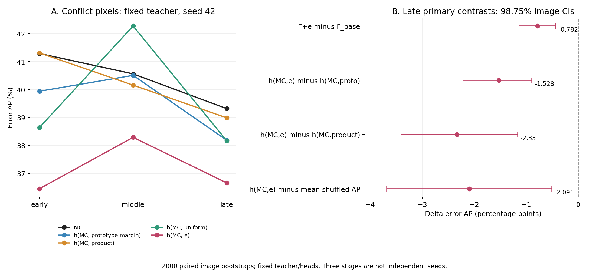
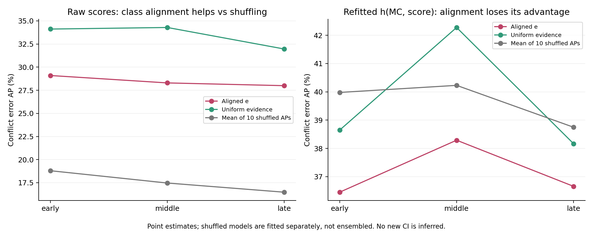

# 第一阶段结果与 BN 检查点审计

更新：2026-10-23，北京时间。对象为 2026-10-20 登记的“标签锚定的竞争类别验证”方案；结果来自正式 seed42 教师及其冻结诊断。本报告是事后分析，不改变原协议、继续门槛或已发布的负向结果。

**当前判断：停止扩展现有 `e=Σr_k[s_k−s_a]+` 与 `h(MC,e)` 方案，暂不进入 seed43 和端到端矩阵。标签锚定这一宽泛方向可以保留一次有边界的修订机会，优先解决原型可信度与评分器保留 MC 信息的问题。BN 保存缺陷已确认并修复；真实 checkpoint 的全验证偏差较小，目前没有证据能把机制失败归因于 BN，但还不能排除它对条件排序的影响。**

## 1. 实际完成范围与证据来源

| 项目 | 已完成内容 |
| --- | --- |
| 数据 | VOC augmented 1/8，原标注预算 1,323 图；D_sup=1,191，D_rel=132，D_U=9,259，validation=1,449 |
| 数据隔离 | 四种角色六组交集全部为零；D_sup 的 21 类均有支持，最少 23 图；D_rel 最少类别只有 2 图 |
| 教师 | 一个 seed42，ResNet101 + DeepLabV3Plus；global batch 16，4 张 RTX 4090，46,240 次更新 |
| 固定阶段 | early=4,624，middle=23,120，late=46,240；同一条训练轨迹的三个 checkpoint |
| 每阶段诊断 | 50 个排序分数、24 个拟合 head、A/B/C/D、原生 CSL/CoVar 控制；每图 1,024 像素主分析及 4,096 像素重拟合敏感性 |
| 统计 | 2,000 次配对图像 bootstrap，抽样池包括子组内无像素的图像；像素使用逆采样概率权重 |
| 主检验 | late 冲突子集的四个 ΔAP，单项 98.75% 区间，Bonferroni 控制四项家族；uniform 是额外保守控制 |
| 未启动 | seed43、P2 的 G0–G7、后续数据集；当前没有新方法端到端 mIoU 或训练成本收益 |

教师于 **10 月 21 日 01:08:52** 完成，耗时 **15 小时 12 分 30 秒**；诊断于 **03:33:53** 完成，额外 **2 小时 25 分 1 秒**。总计约 **17 小时 37 分 31 秒**。三阶段和两种采样量并非六次独立训练。

原协议 SHA256：`01736454eacd2a0942af0bb37a0a2715037c657fd414b5df3ab1be04c34db8b0`。教师源码版本 `b75c0e6d`，冻结分析版本 `7c4c5c09`。本次重新核对本地快照全部 **117 个文件**，大小与 SHA256 无不一致；六个核心评分、导出及统计源码与服务器原自检记录一致。

可复算汇总在 [summary.json](../records/phase1_summary_20261023/summary.json)，全部阶段／采样量排序在 [ranking.csv](../records/phase1_summary_20261023/ranking.csv)。结果汇总脚本为 [summarize_phase1.py](../summarize_phase1.py)，不拟合模型、不重新选阈值、不生成新的置信区间。训练和队列完成记录见 [completion_20261021.json](../records/completion_20261021.json)。

## 2. 主门槛确实失败

以下 AP 都以**错误伪标签为正类**，数值为百分数，越高越好。`h(MC,x)` 使用相同的两输入小网络；`F_base` 包括 MC、margin、entropy、残余 entropy、原型支持、原型间隔、乘积融合和 JS，`F_plus` 再加入 e。预测类别始终是原分类器的 argmax。

| 方法 | early 总体 | middle 总体 | late 总体 | early 冲突内 | middle 冲突内 | late 冲突内 |
| --- | ---: | ---: | ---: | ---: | ---: | ---: |
| MC | 40.200 | 37.656 | 36.288 | 41.292 | 40.562 | 39.319 |
| entropy | 38.426 | 37.413 | 36.107 | 38.852 | 40.692 | 38.911 |
| margin | 39.412 | 36.963 | 35.732 | 40.899 | 39.450 | 38.456 |
| h(MC, prototype margin) | 34.851 | 33.774 | 32.500 | 39.941 | 40.510 | 38.185 |
| h(MC, product) | 40.048 | 37.526 | 35.418 | 41.312 | 40.159 | 38.988 |
| h(MC, uniform) | 35.652 | 34.543 | 32.818 | 38.645 | 42.277 | 38.166 |
| **h(MC,e)** | **35.364** | **33.871** | **32.625** | **36.449** | **38.289** | **36.657** |
| F_base | 35.955 | 33.722 | 32.671 | 37.243 | 39.597 | 37.702 |
| F_plus | 35.731 | 33.623 | 32.333 | 37.249 | 39.048 | 36.920 |
| 原生 CoVar 权重 | 31.271 | 28.641 | 26.734 | 33.892 | 32.494 | 30.376 |
| 原生 CSL 权重 | 29.806 | 26.719 | 25.601 | 32.167 | 30.713 | 30.262 |

原生权重两行只比较同一冻结预测上的排序，不能据此推断端到端训练孰优。MC-only head 在这些总体和冲突比较中的 AP 与 MC 相同。

| late 主比较：冲突内 ΔAP | 差值，百分点 | 98.75% 配对图像区间 |
| --- | ---: | --- |
| F_plus − F_base | −0.782 | [−1.141, −0.438] |
| h(MC,e) − h(MC, prototype margin) | −1.528 | [−2.216, −0.896] |
| h(MC,e) − h(MC, product) | −2.331 | [−3.410, −1.170] |
| h(MC,e) − 十个分别拟合置换版本的平均 AP | −2.091 | [−3.683, −0.515] |

四项区间的上界都低于零。失败不能只解释为“Bonferroni 太严格”或“正向效果没有达到显著性”。uniform 控制也为负：late 的 `h(MC,e)−h(MC,uniform)` 是 **−1.509 个百分点**，95% 区间 **[−2.556, −0.467]**。四个主比较中，仅 F_plus−F_base 在 early 有很小的正点估计，其余三个各阶段都为负。



总体也有损失：late 的 F_plus−F_base 为 **−0.337 个百分点**，95% 区间 **[−0.611, −0.081]**；early 为 −0.224 [−0.429, −0.019]，middle 为 −0.099 [−0.304, +0.107]。

AP 之外保留指标差异。late 总体 MC 的 AUROC/AURC 为 **90.958% / 0.634%**，h(MC,e) 为 **90.530% / 0.654%**。但 F_plus 相对 F_base 的总体 AUROC 从 89.787% 增至 89.953%，AURC 从 0.712% 降至 0.708%，同时 AP 下降。因此不能写成所有指标一致退化；按原定错误检测 AP 主门槛，仍然失败。

## 3. 在相近置信度下，也没有形成稳定增益

已有分层包含 MC 区间、原型间隔区间、预测类别、边界／内部，以及 class×MC×boundary。它们是描述性分层；没有逐层校正区间。**当前代码并未实现 MC×prototype margin 的联合分层**，F_base 也未显式包含预测类别，不能把有限 MLP 比较表述为严格的条件独立性证明。

late 的三个高 MC 区间内，h(MC,e) 的 AP 仍低于 MC：

| MC 区间 | MC AP | h(MC,e) AP | F_base AP | F_plus AP |
| --- | ---: | ---: | ---: | ---: |
| [0.95, 0.975) | 17.842 | 16.453 | 16.267 | 16.230 |
| [0.975, 0.995) | 12.928 | 11.627 | 11.158 | 11.130 |
| [0.995, 1] | 5.040 | 4.954 | 3.909 | 4.146 |

最高 MC 区间中 F_plus 相对较弱的 F_base 有局部正向变化，仍未超过 MC。类别结果有正有负，例如 late 的预测 cat 类有局部增益；不能选择这些子组替代预定主比较。边界像素尤其不利：late 的 MC AP=**63.184%**，h(MC,e)=**51.959%**；内部为 **36.179%** 与 **32.549%**。所有选定分层及支持量见 [conditional_selected.csv](../records/phase1_summary_20261023/conditional_selected.csv)。

采样量增加没有翻转 middle/late 的冲突内方向：

| 阶段 | F_plus−F_base：1,024 总体 | 4,096 总体 | 1,024 冲突内 | 4,096 冲突内 |
| --- | ---: | ---: | ---: | ---: |
| early | −0.224 | +0.338 | +0.006 | +0.812 |
| middle | −0.099 | +0.020 | −0.549 | −0.428 |
| late | −0.337 | −0.185 | −0.782 | −0.524 |

单位为 AP 百分点。4,096 是使用同一缓存扩充像素并重新拟合，未另做区间，不构成独立种子确认。early 的变化提示评分器／抽样敏感性。

## 4. 机制失效的直接证据：原型误报、盲区与权重变换

**原型能够找出部分错误，但自身明显弱于分类器。** late 的像素正确率估计为：分类器 **95.181%**，原型分类器 **82.581%**。下表是各组占全部有效像素的加权比例，不是图像占比，也不是 mIoU。

| late 互补分组 | 像素比例 |
| --- | ---: |
| 双方都正确 | 80.697% |
| 分类器错、原型对 | 1.884% |
| 分类器对、原型错 | 14.484% |
| 双方都错、类别相同 | 2.350% |
| 双方都错、类别不同 | 0.585% |

原型误报对应的正确像素约为可直接纠正错误像素的 **7.69 倍**。冲突覆盖全部像素的 **16.953%**，其中只有 **14.564%** 是分类器错误，另 **85.436%** 分类器其实正确。在 MC≥0.95 的冲突中，分类器正确比例进一步达到 **92.188%**。因此“原型提出异议”并不是足够可靠的降权依据。

**ReLU 反证还存在结构性盲区。** late 只有 **51.238%** 的分类器错误满足 e>0，另外 **48.762%** 在 e=0 区域；高 MC 错误的覆盖率为 **48.087%**。当原型与分类器一致地错时，当前反证无法区分它与一致正确。修改评分器容量不能补回已经被截断成零的信息。

**类别对应不是完全没有信息，但当前残余加权未优于简单控制。** late 冲突内原始分数 AP：e=**27.995%**，top-2=**28.007%**，uniform=**31.959%**，十个 raw 置换 AP 均值=**16.474%**。保留类别对应优于随机破坏对应，但 e 仍低于 uniform。e 与 top-2 的结果非常接近；这与残余概率集中于单一对手的解释相容，但尚未统计真实残余分布，不能直接断言两者等价。

拟合 head 后，h(MC,e)=**36.657%**，h(MC,uniform)=**38.166%**，十个独立拟合的置换 head AP 均值=**38.748%**。这里平均的是 AP，不是把十个预测集成。因此“打乱类别更好”只适用于这组已拟合 head 的比较，不能推导为类别身份本身无用。



## 5. 评分器与实验设置还有哪些限制

1. **当前探针没有保住 MC。** F_base 在三个阶段的总体 AP 都明显低于 MC，尽管它包含 MC。固定 16 个隐藏单元、500 次更新、一次初始化且以总体 BCE/NLL 选 L2，并不保证嵌套模型保留原排序。负向 ΔAP 证明这个预定实现未获益，不能单独证明 e 的条件互信息为零。精简 F_simple 加 e 的总体 AP 有小幅正点估计，但冲突内三阶段仍分别下降 0.889、0.844、0.611 个百分点。
2. **开发集 NLL 的改善未稳定转移。** early/middle 的 h(MC,e) 在 D_rel CV 上比 h(MC) 的 NLL 更低，validation 上却更高。late 的 F_plus CV NLL=0.155140，略低于 F_base 的 0.155545；validation 反而从 0.135889 升至 0.136507。这提示过拟合、数据分布差异或优化目标不匹配，需要原始缓存进一步区分，现有汇总无法确定单一原因。
3. **独立校准图像只有 132 张。** 数百万像素不等于数百万独立监督样本；D_rel 最少类别仅 2 张图。图像级 CV 防止同图泄漏，但无法消除稀有类与边界分布差异。若研究主张是高 MC 冲突内部排序，使用全体像素的自然比例 BCE 会把较多优化预算放在大量容易的正确像素上。改变损失应重新登记，并保留校准性评价。
4. **单类单原型是可信度瓶颈的候选解释。** 它用分类前特征的等图像均值，未表达同类多模态和类间不同尺度；实际原型误报率支持继续查验此环节，但不证明多原型必然奏效。不能靠增加复杂组件来替代简单对照。
5. **融合温度均选到网格上限 T=1。** 这提示应检查融合是否主要依赖 MC，以及 D_rel 温度曲线是否支持继续放宽范围；不能用 validation 再选一个有利温度。当前 product 只是受 HyperMatch 启发的简化控制。

按相同工作点比较，也没有可靠优势。late 总体结果如下：

| 方法 | 固定 90% coverage 的 precision | 固定 98% precision 的描述性 coverage | D_rel 选择阈值后的实际 coverage / precision |
| --- | ---: | ---: | --- |
| MC | 98.084% | 90.561% | 89.310% / 98.180% |
| h(MC,product) | 98.087% | 90.593% | 88.936% / 98.236% |
| h(MC,e) | 97.971% | 89.828% | 89.302% / 98.084% |
| F_base | 97.952% | 89.729% | 89.164% / 98.091% |
| F_plus | 97.943% | 89.615% | 88.752% / 98.117% |

第二列固定覆盖率，第三列由 validation GT 描述曲线，不能直接部署。第四列阈值仅由 D_rel OOF 预测选择，实际精度不完全相同，不能冒充严格的等精度比较。这里没有为微小工作点差值新推导显著性。

校准方面，late raw MC 的 NLL=**0.172143**，h(MC) 降至 **0.129590**；加入 e 后为 **0.132946**。Brier 对应为 0.038761、0.036527、0.037977。简单 MC 校准已取得主要改善，没有证据表明 e 是这部分改善的来源。

## 6. BN 检查点问题：已确认什么，尚不能确认什么

**缺陷路径已确认。** 上游 `ModelBuilder.forward` 在 `track_running_stats=False` 时先把 BN 的 running mean/variance 备份到普通 Python 列表 `saved_bn_stats`；强增强前向仍暂时更新这些 buffer，直到下一次 forward 开始才恢复。正式教师在最后一个强增强前向后、下一次恢复前，通过 `on_train_batch_end` 保存阶段 checkpoint。`state_dict` 保存了临时 buffer，却没有保存该 Python 备份列表。因此重载状态可能与原训练实例下一次 eval 的状态不同。

这是根据实际源码和最小数值复现确认的序列化问题。PyTorch 的 state_dict 保存参数和持久 buffer 的规则可见 [官方序列化说明](https://docs.pytorch.org/docs/2.9/notes/serialization.html)。此前真实 smoke 检查了权重更新、scheduler 和严格加载，但未比较“保存前下一次 eval”与“重载 eval”输出，漏掉了这一项。

**三个真实 checkpoint 均已完成 1,449 张图的 FP32 与 FP16 全验证复算：**

| 阶段 | 训练日志 mIoU | 重载 FP16 | FP16−日志，百分点 | 重载 FP32 | FP32−日志，百分点 |
| --- | ---: | ---: | ---: | ---: | ---: |
| early | 74.062180 | 74.112428 | +0.050248 | 74.114537 | +0.052357 |
| middle | 77.136864 | 77.074199 | −0.062665 | 77.077588 | −0.059276 |
| late | 78.500687 | 78.565134 | +0.064447 | 78.569257 | +0.068570 |

审计使用同版本 PyTorch 2.2.2 和同型号 RTX 4090、同一原图验证设置。由于新实例临时环境丢失，使用镜像内已有运行时，NumPy 为 1.26.4（原运行 1.24.2）；不更新参数或 BN。三阶段的 checkpoint SHA256 均与训练完成记录一致，审计前后全部模型 buffer 相同。FP32 与 FP16 的 mIoU 差仅约 0.0021–0.0041 个点。同精度重载与训练日志仍有约 0.05–0.064 个点差异；这与保存问题相容，但差值也可能包含 DDP/内核执行路径等差异，不能把它全部标为 BN 的纯因果效应。

每阶段对原先确定性选出的完整图缓存中的前 **8 张**重新前向：**24/24 个图像–阶段组合的 GT 相同，FP32 logits 最大绝对差均为 0，argmax 改变像素数均为 0**。这是固定 checkpoint 缓存的一致性证据，覆盖抽查图像，不是对全部特征张量的重新认证。

原始审计记录：[early](../records/checkpoint_bn_audit_20261023/early.json)、[middle](../records/checkpoint_bn_audit_20261023/middle.json)、[late](../records/checkpoint_bn_audit_20261023/late.json)，包含逐类 IoU、混淆矩阵、模型哈希和缓存检查。脚本为 [audit_checkpoint_eval.py](../audit_checkpoint_eval.py)。三项并行审计各约 2 分 32–34 秒，于 **10 月 23 日 07:06–07:07** 完成。

**对研究结论的影响分为三层：**

- 原缓存内所有选择器仍使用同一个固定 checkpoint、原型和像素；目前的负向配对结果是真实观测，没有发现因混用模型而产生的方法间不公平。
- 旧 checkpoint 与内存教师的 BN 状态存在定义偏差，因此当前结果只能严格描述“旧保存方式下的固定教师”。较小的总体 mIoU 差不能约束错误子集排序或原型几何变化；mIoU 与 AP 也不能直接比较量级。
- 目前没有证据证明 BN 导致四个主比较失败，也没有正确 BN 状态下的 AP 结果证明结论完全不变。保留 no-go 资源决策，同时暂缓“整个标签锚定方向已被否定”的外推。

**修复已落地。** [checkpoint_state.py](../checkpoint_state.py) 在 `trainer.save_checkpoint` 捕获 state_dict 之前主动恢复待回滚 BN；[train_teacher.py](../train_teacher.py) 为新 checkpoint 和运行签名记录修复策略，保存时断言无待恢复状态，加载时拒绝将旧策略 checkpoint 默默续训成“已修复”实验。旧协议和四个旧 checkpoint 均未改写。上游原来未回滚的 `num_batches_tracked` 行为保持；其 BN 使用固定 momentum，本修复处理的是影响 eval 的 running mean/variance。

最终本地 **31/31 检查通过**，包括真实上游 BN 方法复现、torch.save/load 序列化、修复后输出一致、参数/RNG 不变、重复恢复无副作用、旧 checkpoint 恢复防护，以及原有数值、数据隔离、排序、图像 bootstrap 和门槛检查。记录见 [selfcheck_bn_serialization_20261023.json](../records/selfcheck_bn_serialization_20261023.json)。新修复尚未经历一条完整教师训练。

丢失的旧 BN 备份不在 state_dict 中，不能从当前文件精确还原。事后重校准 BN 是一个新的干预，不能称为恢复了原始内存教师。若进行正式修复确认，应使用新输出目录和新源码版本保存教师，重新导出 D_sup 原型、D_rel 与 validation，不能只替换 logits 或沿用旧原型。

## 7. 审计结论的证据等级

| 问题 | 当前状态 | 证据或限制 |
| --- | --- | --- |
| 汇总损坏／引用了未完成任务 | 已排除本地汇总层面问题 | 117 个快照文件校验，完整完成标记；周期 progress.json 的旧 running 不代表仍在训练 |
| GT 泄漏、分区重叠、错误正类反向 | 未发现 | 划分交集与源码检查、自检；D_rel 拟合，validation 评价 |
| 极高 MC 的残余除零、置换改变原始伪标签 | 未发现 | 排除 top-1 后直接 logits softmax；身份固定置换和数值测试 |
| 特征采样几何、head 梯度回传、batch 依赖 | 合成与 smoke 检查通过 | 取样后归一化，align_corners=True，输入 detached；本次未完整重算所有真实特征缓存 |
| 像素当独立样本、并列 AP、空子组图像 | 未发现 | 图像配对重采样、IPW、并列统计自检；不是训练种子总体区间 |
| BN 保存／重载不一致 | **确认并修复** | 实际源码、数值复现和真实全验证；排序结论的因果影响尚未量化 |
| MLP 未保住 MC、CV 改善未转移 | **实测现象** | 多阶段 AP/NLL，需区分优化、过拟合、分布偏移 |
| 原型误报多、e=0 盲区大 | **实测现象** | 互补分组及错误覆盖率 |
| 残余概率退化为 top-2、边界特征混合原因 | 待验证解释 | AP 接近／边界损失只提供线索，缺少对应分布和特征干预证据 |
| 严格控制 MC 与原型间隔后的独立信息 | 尚未充分检验 | 缺联合分层与更可靠的保留 MC 探针；当前有有限 MLP 增量比较 |

## 8. 下一步调整顺序与停止条件

**第一步：用现有缓存做一次有边界的评分器审计。** 在 D_rel 按图像交叉验证，固定 MC-only 校准器作为起点，用少量线性／加性修正比较 prototype margin、product、uniform、e；显式包含可退回 MC 的零修正候选。只追加原 500 与一个预定的较大更新预算，例如 2,000，记录训练和 OOF 曲线。这样可以区分“信息没有帮助”与“自由小 MLP 丢失强 MC 基线”。所有选择留在 D_rel；已查看的 validation 只用于开发描述，不再充当未触及的确认集。

同步补齐 MC×prototype margin 联合分层、预测类和边界支持量；从实际缓存统计残余最大概率、e/top-2 的相关性、D_rel 与 validation 的错误率和特征分布。阈值或分层边界先固定，不按结果筛选类别。

**第二步：只有发现可重复的开发增量，才花一次教师训练做修复确认。** 新版保存流程先通过真实多卡短 smoke 的内存 eval／重载 eval 一致性检查，再用相同 seed42、数据和预算重训一条轨迹。保留旧版作为历史对照，统一重建各阶段原型和全部缓存；将 BN 修复与方法改动分开记录。当前 mIoU 差较小，不足以支持立即重跑完整矩阵；如果现有缓存的保留 MC 探针仍不支持 e，先终止这版公式更节省算力。

**第三步：把研究问题收窄为“何时应相信标签锚点提出的异议”。** 先检验按类别／原型支持量估计异议可信度能否减少误杀，并保留对一致错误的诊断。若需要多原型或新表征，应先证明单原型的局限及简单校准控制不足，再增加机制。原型正确率提高本身不是最终目标，目标仍是超过 MC、普通原型间隔、uniform 和 product 的同覆盖率／同精度收益。

**不建议直接把 ReLU 改成 signed evidence 就作为新主线。** 对 `q_k∝exp(s_k/T)` 的普通乘积融合，原伪标签支持 S 满足精确恒等式：

\[
\operatorname{logit} S
=\operatorname{logit} m-\log\mathbb{E}_{k\sim r}\exp((s_k-s_a)/T).
\]

signed evidence `E_r(s_k−s_a)` 已是右侧 log-moment 在大 T 下的一阶项。独立数值核验的 float64 最大误差约 1.42×10⁻¹⁴，见 [语义审计记录](../records/independent_semantics_audit_20261021.json)。改变符号或截断并不自动建立区别于普通融合的新机制。[HyperMatch](https://davar-lab.github.io/files/cvpr2023_hypermatch/HyperMatch-Camera-Ready.pdf) 已使用标注语义中心与预测融合；[ConMatch](https://www.ecva.net/papers/eccv_2022/papers_ECCV/papers/136900665.pdf) 已研究可学习置信度估计。当前小 head 与原型组合本身不足以支撑新颖性主张。

修订版只有在正确快照、保留 MC 的强基线下，仍有冲突内条件增量，且不以总体明显退化换取局部收益，才值得重新登记独立种子和第二数据集确认。若优势只来自 MC 校准、普通原型或 product，应转向报告与研究这些因素；若 e 仍被 uniform／product 稳定覆盖，则结束残余竞争加权主线。

## 9. 本轮交付与复现

新增内容包含 BN 保存修复及回归检查、三个真实 checkpoint 的审计 JSON、完整阶段汇总表、两张静态科研图、分析脚本和本报告。原始模型、图像、像素张量及认证文件不进入 GitHub。分支保持 `research/label-anchored-competition`。

复算汇总（输出目录必须不存在）：

```bash
python -m research.label_anchored_competition.summarize_phase1 \
  --snapshot /path/to/server_snapshot_20261021T0841Z_completed \
  --output /new/summary-directory --figures
```

实际新模型训练、修复后 AP、评分器再拟合及后续数据集结果尚未产生；它们没有混入本报告的原始结果表。
